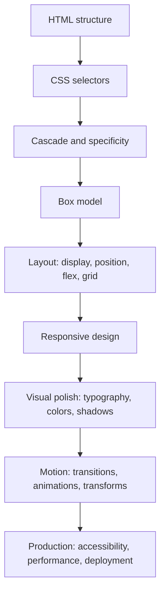

# CSS Complete Course: Beginner to Advanced

This folder is a complete CSS learning pack based on the supplied 10+ hour roadmap and expanded beyond it with practical examples, projects, deployment steps, and revision notes.

## Study Order

1. Read `docs/00_COVERAGE_MATRIX.md`.
2. Study `docs/01_CSS_FOUNDATIONS_AND_CASCADE.md`.
3. Study layout chapters: box model, display, position, units, float, flexbox, grid.
4. Study visual chapters: typography, colors, shadows, transitions, animations, transforms.
5. Run the examples in `examples/`.
6. Build the full projects in `projects/`.
7. Read `docs/09_DEPLOYMENT_AND_PRODUCTION_CHECKLIST.md`.

## Folder Map

| Folder/File | Purpose |
| --- | --- |
| `docs/` | Complete notes and line-by-line explanations |
| `examples/` | Small focused demos for individual CSS concepts |
| `projects/recipe_site` | Recipe website project |
| `projects/cards_site` | Cards website project |
| `projects/blog_grid_site` | Blog/grid website project |
| `projects/transform_gallery` | 2D/3D transform and animation project |

## Run Any HTML File

These are static HTML/CSS projects. Open any `index.html` file in a browser.

Optional local server:

```bash
python -m http.server 8000
```

Then open:

```text
http://localhost:8000
```

## Big Picture



