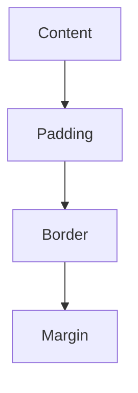

# 03. Box Model, Display, Position, and Units

## Box Model

Every element is a box.



CSS:

```css
.box {
  width: 300px;
  padding: 20px;
  border: 4px solid black;
  margin: 30px;
}
```

Explanation:

- `width` controls content width.
- `padding` adds space inside the border.
- `border` wraps padding and content.
- `margin` adds space outside the element.

## Box Sizing

Default:

```css
box-sizing: content-box;
```

Better for most layouts:

```css
* {
  box-sizing: border-box;
}
```

With `border-box`, width includes content, padding, and border.

## Display

### Block

```css
div {
  display: block;
}
```

Block elements:

- Start on a new line.
- Take full available width.
- Can have width and height.

Examples: `div`, `p`, `section`, `h1`.

### Inline

```css
span {
  display: inline;
}
```

Inline elements:

- Stay in line with text.
- Width and height do not work normally.

Examples: `span`, `a`, `strong`.

### Inline-Block

```css
.tag {
  display: inline-block;
}
```

Inline-block:

- Flows inline.
- Allows width, height, padding, margin.

## Position

### Static

Default position.

```css
.item {
  position: static;
}
```

### Relative

Moves relative to normal position.

```css
.item {
  position: relative;
  top: 10px;
  left: 20px;
}
```

The original space remains.

### Absolute

Positions relative to nearest positioned ancestor.

```css
.parent {
  position: relative;
}

.badge {
  position: absolute;
  top: 10px;
  right: 10px;
}
```

### Fixed

Positions relative to viewport.

```css
.navbar {
  position: fixed;
  top: 0;
  left: 0;
  right: 0;
}
```

### Sticky

Behaves normal until it reaches a scroll position.

```css
.sidebar {
  position: sticky;
  top: 20px;
}
```

## Units

### px

Fixed pixel size.

```css
font-size: 16px;
```

### %

Relative to parent.

```css
width: 50%;
```

### vw and vh

Relative to viewport.

```css
.hero {
  min-height: 100vh;
  width: 100vw;
}
```

### em

Relative to current element font size.

```css
padding: 2em;
```

### rem

Relative to root font size.

```css
h1 {
  font-size: 3rem;
}
```

Use `rem` for scalable typography and spacing.

