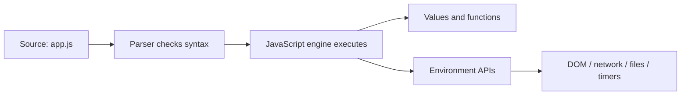

# 00 — Learning System, Setup, and How Programs Run

## Aim

Build a setup that gives fast feedback, and learn the smallest mental model for executing code. Tools do not make you a programmer; tight feedback loops do.

## 1. The three places JavaScript runs

1. **Browser console:** best for tiny experiments. Open DevTools with `F12`, choose Console.
2. **Browser page:** best for DOM, events, forms, storage, and network requests.
3. **Node.js:** best for scripts, packages, files, servers, and tooling.

Create a folder for experiments. The following three files are enough for browser practice:

```html
<!-- index.html -->
<!doctype html>
<html lang="en">
  <head>
    <meta charset="UTF-8" />
    <meta name="viewport" content="width=device-width, initial-scale=1.0" />
    <title>JavaScript playground</title>
    <script defer src="app.js"></script>
  </head>
  <body>
    <h1>JavaScript playground</h1>
  </body>
</html>
```

```js
// app.js
console.log("The JavaScript file loaded.");
```

### Line by line

- `<!doctype html>` asks the browser to use modern standards mode.
- `meta charset` lets text such as emoji and non-English characters work correctly.
- `meta viewport` makes mobile layout use the device width.
- `defer` downloads `app.js` while HTML is read, then runs it after HTML is parsed. This is usually the safest default for a page script.
- `console.log` sends a value to DevTools; it does not display text on the page.

## 2. From source code to result

Your source text is parsed into a structure, executed by a JavaScript engine, and allowed to use APIs from its environment.



If parsing fails, the program cannot start: this is a **syntax error**. If the program starts but reaches an impossible action, such as calling a non-function, it is a **runtime error**. If it runs but gives the wrong result, it is a **logic error**.

## 3. The console, debugger, and breakpoints

Prefer meaningful logging:

```js
const price = 120;
const quantity = 3;
const total = price * quantity;

console.log({ price, quantity, total });
debugger; // DevTools pauses here when open.
```

The object shorthand `{ price, quantity, total }` labels each value. It is clearer than three unrelated logs. At a breakpoint, step over the next line, inspect variables, and form a prediction before continuing.

## 4. Small program anatomy

```js
function calculateDiscountedPrice(price, percent) {
  const discount = price * (percent / 100);
  return price - discount;
}

const finalPrice = calculateDiscountedPrice(500, 10);
console.log(finalPrice); // 450
```

- `function` creates reusable behavior; it does not run the body yet.
- `price` and `percent` are parameters: local names for values a caller supplies.
- `const discount` stores an intermediate result.
- `return` sends a value out and ends this function call.
- `calculateDiscountedPrice(500, 10)` calls the function. `500` and `10` are arguments.
- The call expression evaluates to `450`; that value is stored in `finalPrice`.

## 5. A reliable thinking procedure

For every problem, write this before coding:

| Question | Example: cart total |
|---|---|
| What is the input? | An array of `{ price, quantity }` items |
| What is the output? | One number: the total price |
| What rules apply? | Price cannot be negative; quantity is positive |
| What are edge cases? | Empty cart, missing data, decimals |
| What are the steps? | Validate → multiply → add → format |

Then make a tiny pure function before touching UI. A function that calculates data is easier to test than one that also reads the DOM and displays a popup.

## 6. Git habit (start now)

```bash
git init
git add .
git commit -m "Start JavaScript practice"
```

Commit after a small working slice. A commit is a named restore point, not a final exam.

## Try it

1. Make a page with your name in an `h1`; log the text of the heading.
2. Write `areaOfRectangle(width, height)`. Test normal, zero, and decimal inputs.
3. Intentionally create a syntax error and a runtime error. Read the exact DevTools messages, then fix them.
4. Use a breakpoint to trace `calculateDiscountedPrice` with price `199.99` and percent `15`.

Next: [01 — JavaScript foundations](./01-javascript-foundations.md).
