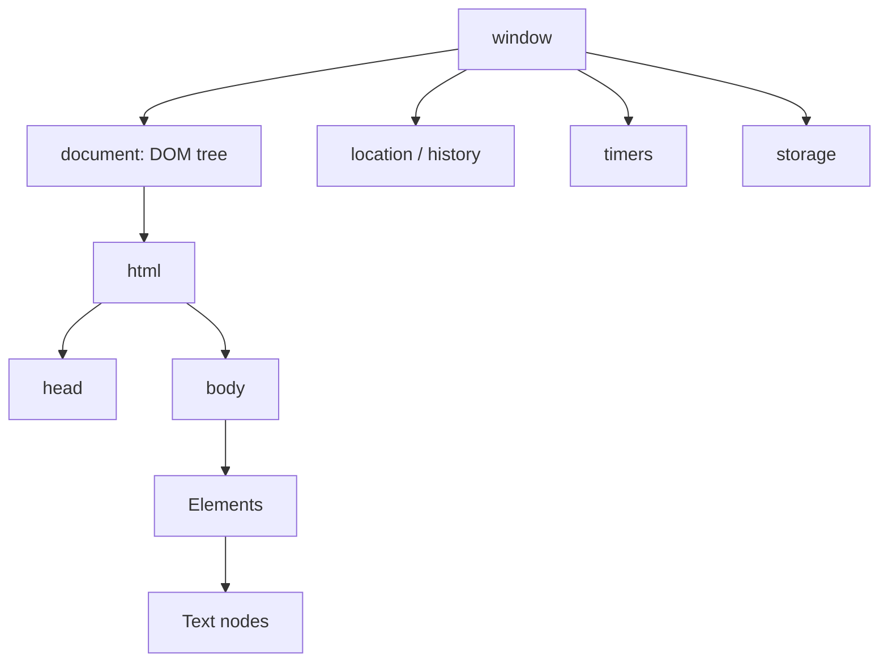
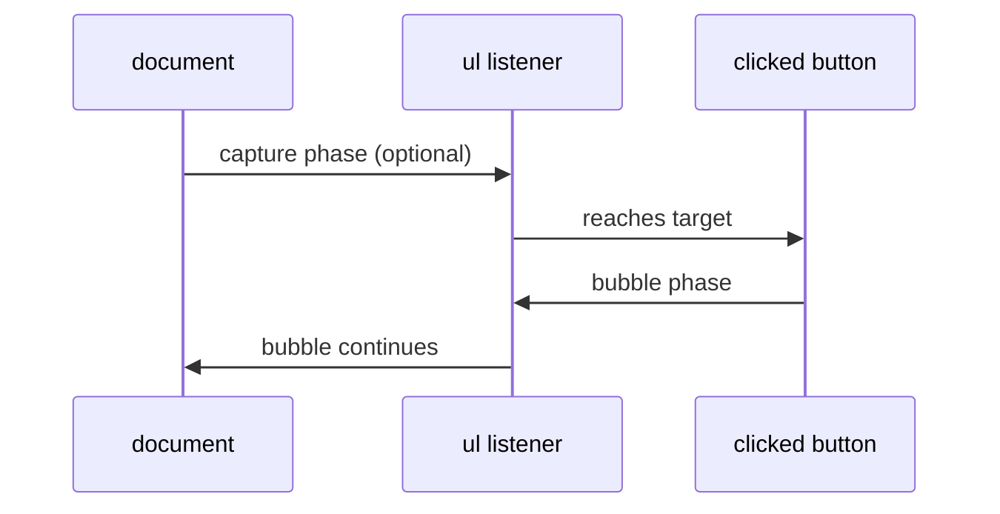
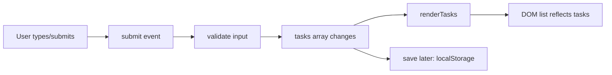

# 03 — Browser JavaScript: DOM, Events, Forms, and Accessible UI

## Aim

Use JavaScript to make pages respond to people. Learn the DOM as a tree, events as messages moving through that tree, and forms as user data that must be validated respectfully.

## 1. Browser, BOM, and DOM

The **DOM** (Document Object Model) is the browser’s live object tree for HTML. The **BOM** (Browser Object Model) is broader browser functionality exposed through `window`: location, history, timers, storage, and more. In browser scripts, `window` is the global object; writing `window.alert` and `alert` means the same built-in function.



Select DOM elements once, name them by their role, and check that the selector is correct.

```html
<button class="js-increase" type="button">Increase</button>
<output class="js-count">0</output>
```

```js
const increaseButton = document.querySelector(".js-increase");
const countOutput = document.querySelector(".js-count");

if (!increaseButton || !countOutput) {
  throw new Error("Expected counter elements are missing");
}
```

`querySelector` returns the first matching element or `null`. `querySelectorAll` returns a static `NodeList`, which you can iterate. Prefer `data-*` attributes or `js-` classes for JavaScript hooks; do not couple behavior to visual CSS class names.

## 2. Render from state, not scattered DOM changes

Keep the data in JavaScript and write one small function that makes the DOM match it.

```js
let count = 0;

function render() {
  countOutput.value = String(count);
  increaseButton.disabled = count >= 10;
}

increaseButton.addEventListener("click", () => {
  count += 1;
  render();
});

render();
```

The source of truth is `count`, not the text currently visible in the page. `render` changes only the output and button state derived from it. React makes this model systematic later.

## 3. Create, change, and remove elements safely

Use DOM APIs for user-provided text. Assigning untrusted content to `innerHTML` can create an XSS security hole.

```js
function createTaskItem(task) {
  const item = document.createElement("li");
  const label = document.createElement("span");
  const removeButton = document.createElement("button");

  label.textContent = task.title; // text, not HTML
  removeButton.type = "button";
  removeButton.textContent = "Remove";
  removeButton.dataset.id = task.id;

  item.append(label, removeButton);
  return item;
}
```

Useful operations:

- `element.textContent = value`: safe text content.
- `element.classList.add/remove/toggle`: update classes.
- `element.setAttribute`: update an HTML attribute; use DOM properties such as `input.value` for live form value.
- `parent.append(child)`, `before`, `after`, `replaceWith`, `remove`: change structure.
- `element.closest(selector)`: find matching self/ancestor.
- `element.matches(selector)`: test an element.
- `parent.contains(child)`: test ancestry.

Use `innerHTML` only with fully trusted, carefully controlled markup. Sanitizing arbitrary HTML correctly is a separate security task.

## 4. Events: a message travels through the tree

An event has a type (`click`, `input`, `submit`, `keydown`), a target (the deepest originating element), and a current target (the listener currently handling it). It normally travels capture phase → target → bubble phase.



### Event delegation

Put one listener on a stable parent and identify the clicked control with `closest`. This handles buttons created later too.

```js
taskList.addEventListener("click", (event) => {
  const button = event.target.closest("button[data-id]");
  if (!button || !taskList.contains(button)) return;

  const id = button.dataset.id;
  tasks = tasks.filter((task) => task.id !== id);
  renderTasks();
});
```

- `event.target` could be an icon inside a button; `closest` gets the intended button.
- The `contains` check prevents handling a matching element outside this list.
- `dataset.id` is always a string. Convert it if your data uses numbers.

Use `event.preventDefault()` only to replace a browser default deliberately, such as submitting a form with JavaScript. `stopPropagation()` is rarely the answer; it can break parent behavior and analytics. Prefer clear event boundaries.

### Event listener cleanup

Passing the same function reference allows removal:

```js
function handleResize() {
  console.log(window.innerWidth);
}

window.addEventListener("resize", handleResize);
window.removeEventListener("resize", handleResize);
```

Anonymous functions cannot be removed later unless saved in a variable. For multiple listeners, `AbortController` is clean:

```js
const controller = new AbortController();
document.addEventListener("click", handleClick, { signal: controller.signal });
controller.abort(); // removes listeners using this signal
```

## 5. Forms: semantic HTML first

Forms work without JavaScript and provide keyboard, label, and validation behavior. Preserve that foundation.

```html
<form class="js-signup" novalidate>
  <label>
    Email
    <input name="email" type="email" autocomplete="email" required />
  </label>
  <p class="js-error" role="alert"></p>
  <button>Join</button>
</form>
```

```js
const form = document.querySelector(".js-signup");
const error = document.querySelector(".js-error");

form.addEventListener("submit", async (event) => {
  event.preventDefault();
  const data = new FormData(form);
  const email = String(data.get("email") ?? "").trim();

  if (!email.includes("@")) {
    error.textContent = "Enter a valid email address.";
    return;
  }

  error.textContent = "";
  // await sendSignup({ email });
});
```

`FormData` reads successful named controls. `novalidate` is used here only because the script is showing custom validation; normally use native constraints (`required`, `type="email"`, `minlength`, etc.) first. Always validate again on the server: browser validation can be bypassed.

### Input events and accessibility

- `input`: value changes while the user edits; good for live previews.
- `change`: value is committed; behavior differs by control.
- `submit`: the form is submitted by click or Enter; use this, not only a button `click` handler.
- Use real `<button>` and `<a>` elements. A clickable `div` loses keyboard and semantic behavior.
- Every input needs a visible associated `<label>` or an equivalent accessible name.
- Move focus intentionally after an error or dialog opens; do not move it gratuitously.

## 6. Timers and animation frames

`setTimeout` schedules work no earlier than a delay; it is not a precise clock. `setInterval` can drift and overlap long asynchronous work. For visual animation, use `requestAnimationFrame`.

```js
let timerId = window.setTimeout(() => {
  console.log("Runs later");
}, 500);

clearTimeout(timerId); // cancels if it has not run
```

For repeated polling, schedule the next timeout after the current operation finishes rather than using a blind interval.

## 7. Web platform boundaries and security basics

Client code is public. Do not store secrets in JavaScript bundles or local storage. Treat URL parameters, form inputs, server data, and storage as untrusted. Use `textContent` for text, encode URLs appropriately, use HTTPS, and design server-side authorization even if the UI hides a button.

Avoid `eval`, `new Function`, inline user HTML, and dynamically formed script URLs. A Content Security Policy and trusted types are advanced defense layers; secure rendering is still the foundation.

## Mini-project: accessible todo list architecture



Build it in the labs, with add, complete, delete, empty state, keyboard use, and persistence.

## Try it

1. Make a counter with increment, decrement, reset, a minimum of 0, and disabled decrement state.
2. Build a character counter using the `input` event. Announce remaining characters accessibly without shouting on every keystroke.
3. Create a list of cards using `document.createElement`, never `innerHTML` for user text.
4. Build a form that validates a title and deadline; focus the first invalid input.
5. Use event delegation to mark a generated todo complete.

Next: [04 — Asynchronous JavaScript, network, and storage](./04-async-network-storage.md).
