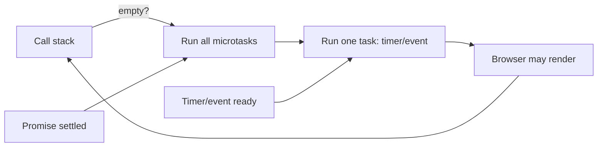

# 04 — Asynchronous JavaScript: Event Loop, Promises, APIs, Errors, and Storage

## Aim

Build a correct mental model for work that finishes later: timers, network requests, user events, and storage. “Async” does not mean JavaScript runs two pieces of your code at exactly the same time; it means your code coordinates with work that becomes ready later.

## 1. Synchronous work and the call stack

JavaScript executes your synchronous code one frame at a time on a call stack. A function call adds a frame; returning removes it. A long calculation blocks user input and painting because the stack cannot do anything else meanwhile.

```js
function greet(name) {
  return `Hello, ${name}`;
}

console.log(greet("Asha"));
console.log("Finished");
```

The first `console.log` must finish before the second runs. This simple rule still holds inside an `async` function between `await` points.

## 2. The event loop, task queue, and microtask queue

Browser APIs may finish a timer or network operation while JavaScript is busy. They queue a callback to be run when the call stack is empty. Promise reactions are **microtasks**, which run before the browser takes the next ordinary task.

```js
console.log("A");

setTimeout(() => console.log("timer"), 0);
Promise.resolve().then(() => console.log("promise"));

console.log("B");
// A, B, promise, timer
```



Do not use zero-delay timers as a general way to “wait for React/DOM”; understand the actual lifecycle instead. Avoid endlessly scheduling microtasks, because the browser cannot render until they finish.

## 3. Callbacks and why promises exist

A callback is a function another function calls later. They are normal and useful. Trouble appears when dependent steps nest deeply and each needs error handling.

```js
readUser(userId, (userError, user) => {
  if (userError) return showError(userError);
  readOrders(user.id, (ordersError, orders) => {
    if (ordersError) return showError(ordersError);
    showOrders(orders);
  });
});
```

A `Promise` represents one eventual result: **pending**, then permanently **fulfilled** with a value or **rejected** with a reason. It makes success/error flow composable.

```js
function wait(milliseconds) {
  return new Promise((resolve) => {
    setTimeout(resolve, milliseconds);
  });
}

wait(500).then(() => console.log("Half a second passed"));
```

Creating `new Promise` is uncommon in application code; APIs such as `fetch` already return promises. Do not wrap an existing promise in a needless new Promise.

## 4. Promise chaining

Return the next promise/value from a `.then` callback. A thrown error or rejection skips success handlers until a `.catch`.

```js
fetch("/api/profile")
  .then((response) => {
    if (!response.ok) throw new Error(`HTTP ${response.status}`);
    return response.json();
  })
  .then((profile) => profile.name)
  .then((name) => console.log(`Hello, ${name}`))
  .catch((error) => console.error("Could not load profile:", error))
  .finally(() => console.log("Request attempt finished"));
```

`.finally` does cleanup regardless of outcome and normally passes the original result through. Do not use it to transform a successful value.

### Concurrency helpers

| API | Use when | Important behavior |
|---|---|---|
| `Promise.all` | every result is required | rejects on the first rejection |
| `Promise.allSettled` | report all outcomes | always fulfills with status objects |
| `Promise.race` | first settlement wins | can reject or fulfill first |
| `Promise.any` | first successful result wins | rejects only if all reject |

```js
const [profile, notifications] = await Promise.all([
  fetchProfile(),
  fetchNotifications(),
]);
```

Start independent requests together, then await them together. Do not accidentally serialize them as `await fetchProfile(); await fetchNotifications()` when no dependency exists.

## 5. `async` and `await`

An `async` function always returns a promise. `await` pauses **that function** until a promise settles; it does not freeze the entire page.

```js
async function loadProfile(id) {
  const response = await fetch(`/api/profiles/${encodeURIComponent(id)}`);

  if (!response.ok) {
    throw new Error(`Profile request failed: ${response.status}`);
  }

  const profile = await response.json();
  return profile;
}

async function showProfile(id) {
  try {
    const profile = await loadProfile(id);
    console.log(profile.name);
  } catch (error) {
    console.error(error);
  }
}
```

- `encodeURIComponent` prevents a dynamic path value from changing URL syntax.
- `fetch` resolves even for HTTP 404/500; only network-level failure rejects. Check `response.ok`.
- `response.json()` is asynchronous because reading/parsing the body happens later.
- `try` contains code that may throw/reject; `catch` receives the error.

## 6. Fetch API: request, response, cancellation, and race conditions

`fetch(url, options)` sends an HTTP request. Typical options include `method`, `headers`, `body`, and `signal`. Send JSON explicitly:

```js
async function createTask(title) {
  const response = await fetch("/api/tasks", {
    method: "POST",
    headers: { "Content-Type": "application/json" },
    body: JSON.stringify({ title }),
  });

  if (!response.ok) throw new Error("Could not create task");
  return response.json();
}
```

Never assume responses are safe simply because they are JSON. Validate required fields before using them. Server authentication and authorization are the server’s job; a browser header or hidden button is not protection.

### Cancel work no longer needed

When a user rapidly changes search text, an old slow response can overwrite a newer result. Cancel the old request or verify a request ID.

```js
let activeController;

async function search(query) {
  activeController?.abort();
  activeController = new AbortController();

  try {
    const response = await fetch(`/api/search?q=${encodeURIComponent(query)}`, {
      signal: activeController.signal,
    });
    if (!response.ok) throw new Error("Search failed");
    return await response.json();
  } catch (error) {
    if (error.name === "AbortError") return null; // expected cancellation
    throw error;
  }
}
```

## 7. Errors: handle at the correct boundary

An error is information about a failed assumption. Catch errors where you can decide a meaningful recovery: show retry UI, return a fallback, or add context and rethrow. Do not swallow errors silently.

```js
class ValidationError extends Error {
  constructor(message, field) {
    super(message);
    this.name = "ValidationError";
    this.field = field;
  }
}

function validateTitle(title) {
  if (title.trim().length < 3) {
    throw new ValidationError("Title must have 3 characters", "title");
  }
}
```

Use `finally` to stop a loading indicator, release a resource, or close a connection. Avoid showing raw server error text to end users; it may expose details. Log enough context for developers without logging passwords, tokens, or sensitive user data.

## 8. Browser storage, cookies, and URL state

| Place | Lifetime / scope | Good for | Do not use for |
|---|---|---|---|
| `localStorage` | persists per origin | small non-sensitive preferences | secrets, large/canonical app data |
| `sessionStorage` | one tab session | temporary per-tab state | authentication secrets |
| Cookie | browser sends to matching server | server-managed session with secure flags | large client data |
| URL query/path | shareable/bookmarkable | filters, route identity, pagination | private state |
| IndexedDB | persistent client database | larger offline data | simple values where storage is enough |

`localStorage` is synchronous and only stores strings. Parse defensively; corrupt/old values happen.

```js
function loadTheme() {
  try {
    return localStorage.getItem("theme") ?? "system";
  } catch {
    return "system"; // storage can be blocked
  }
}

function saveTheme(theme) {
  localStorage.setItem("theme", theme);
}
```

Cookies that hold sessions should normally be set by the server with `HttpOnly`, `Secure`, and appropriate `SameSite` attributes. JavaScript cannot read `HttpOnly` cookies, which reduces token theft through XSS. You still need CSRF protections appropriate to the authentication design.

## 9. Debounce and throttle

**Debounce** waits until input stops, useful for a search request. **Throttle** limits a repeating action to a maximum rate, useful for some scroll/resize work.

```js
function debounce(callback, delay) {
  let timerId;
  return (...args) => {
    clearTimeout(timerId);
    timerId = setTimeout(() => callback(...args), delay);
  };
}

const delayedSearch = debounce((query) => search(query), 300);
```

The closure remembers one `timerId`. Every new input clears the previous scheduled call. Still cancel the actual fetch; debouncing alone does not solve stale responses.

## Try it

1. Predict the output order of a script containing nested promises and `setTimeout` calls, then test it.
2. Write `getJson(url)` that checks `response.ok`, returns parsed JSON, and adds URL context to an error.
3. Build a search box that debounces 300ms and cancels its previous request.
4. Save a theme preference to localStorage with a safe fallback for invalid values.
5. Make a “loading / success / empty / error” state machine for a request. Do not use one ambiguous `isLoading` boolean alone.

Next: [05 — Node, modules, quality, and tooling](./05-node-modules-quality.md).
