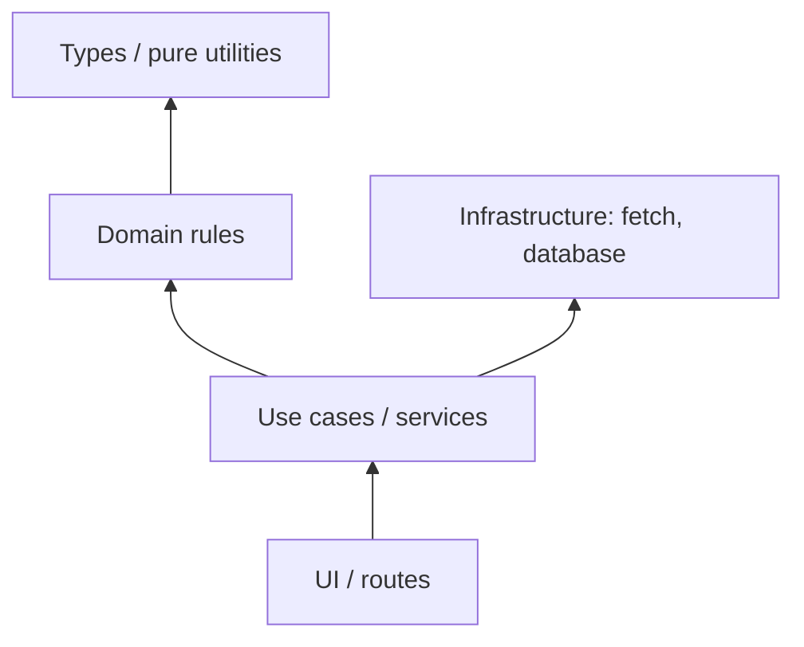

# 05 — Professional JavaScript: Node, Modules, Packages, Tests, Security, and Performance

## Aim

Move from a browser-only learner to a developer who can organize code, use the package ecosystem safely, build a simple backend, test behavior, and make evidence-based quality decisions.

## 1. Node.js and npm

Node.js runs JavaScript outside the browser. It provides server and operating-system APIs such as files, processes, HTTP, streams, and buffers. It does not provide a DOM by default.

`npm` is Node’s package manager and script runner. In a new folder:

```bash
npm init -y
npm install express
npm install --save-dev vitest eslint prettier
```

This creates `package.json` (project metadata and dependencies) and a lock file (the exact dependency tree). Commit the lock file. Do not commit `node_modules`; anyone can recreate it with `npm install` or `npm ci`.

```json
{
  "name": "task-api",
  "private": true,
  "type": "module",
  "scripts": {
    "dev": "node --watch src/server.js",
    "test": "vitest run",
    "lint": "eslint ."
  }
}
```

- `private: true` prevents accidental publishing.
- `type: module` makes `.js` use modern ES module syntax in Node.
- `scripts` provide shared, documented commands. Run them with `npm run dev` or `npm test`.

## 2. Modules and dependency direction

Modules give each file a boundary. Export a small public API; keep implementation details private. ES modules are the standard format in browsers and modern Node.

```js
// src/money.js
export function formatINR(paise) {
  return new Intl.NumberFormat("en-IN", {
    style: "currency",
    currency: "INR",
  }).format(paise / 100);
}

// src/app.js
import { formatINR } from "./money.js";

console.log(formatINR(12500)); // ₹125.00
```

Use named exports by default; they make imports explicit and support tooling. Avoid circular dependencies: when A imports B and B imports A, initialization order becomes confusing. Refactor shared concepts into a third lower-level module.



Higher-level code may depend on lower-level code; a pure domain rule should not import the UI. This makes tests easy and changes local.

## 3. CommonJS and ESM

Older Node projects may use CommonJS:

```js
const fs = require("node:fs");
module.exports = { readFile };
```

New projects should generally use ESM (`import` / `export`). Learn to recognize both; do not mix them casually in one file. In Node ESM, relative imports normally include the `.js` extension.

## 4. A minimal Express API

This is an educational in-memory example, not a production database.

```js
// src/server.js
import express from "express";

const app = express();
app.use(express.json());

const tasks = [];

app.get("/api/tasks", (request, response) => {
  response.json(tasks);
});

app.post("/api/tasks", (request, response) => {
  const title = String(request.body?.title ?? "").trim();
  if (title.length < 3) {
    return response.status(400).json({ message: "Title needs at least 3 characters" });
  }

  const task = { id: crypto.randomUUID(), title, completed: false };
  tasks.push(task);
  return response.status(201).json(task);
});

app.listen(3000, () => console.log("API at http://localhost:3000"));
```

### Line by line

- `express()` creates the application.
- `express.json()` parses JSON request bodies; it must run before routes that read `request.body`.
- Routes pair an HTTP method and URL with a handler.
- Treat `request.body` as untrusted: normalize and validate it on the server.
- `return` after a response prevents accidental second responses.
- A successful creation conventionally returns status `201` and the created resource.
- `crypto.randomUUID()` makes an ID; a real production API normally uses a database.

Production needs a database, authentication/authorization, validation schema, request size limits, rate limiting, logs, error middleware, environment configuration, backups, and deployment safeguards. An Express route alone is not a secure backend.

## 5. Environment variables and secrets

Configuration differs by environment. Read it from environment variables, validate it at startup, and keep `.env` out of Git.

```js
const port = Number(process.env.PORT ?? 3000);
if (!Number.isInteger(port) || port <= 0) {
  throw new Error("PORT must be a positive integer");
}
```

`.env` is a local convenience file, not security. Put secret values in your host’s secret manager in deployment. Never expose a server-only secret with a frontend build variable; anything bundled for the browser is visible.

## 6. Testing: prove behavior

Good tests use arrange → act → assert, describe behavior, and avoid implementation details.

```js
// src/money.test.js
import { describe, expect, it } from "vitest";
import { formatINR } from "./money.js";

describe("formatINR", () => {
  it("formats paise as Indian currency", () => {
    const result = formatINR(12500);
    expect(result).toContain("125");
  });
});
```

Test levels:

| Level | Tests | Example |
|---|---|---|
| Unit | one function/module | tax calculation rejects negative input |
| Integration | modules work together | route validates then saves through a repository |
| End-to-end | user-visible workflow | user signs in and completes a task |

Start with important pure logic. Tests are not a count target; a brittle test that merely checks a private function call gives little confidence.

## 7. Linting, formatting, types, and documentation

- **Formatter:** changes presentation consistently; Prettier is common.
- **Linter:** flags suspicious code and style rules; ESLint is common.
- **Type checker:** catches incompatible shapes before runtime; TypeScript is the common choice, while JavaScript can use JSDoc and `checkJs`.
- **Documentation:** explains why, contract, constraints, and examples—not obvious syntax.

JSDoc can improve a JavaScript editor’s checks:

```js
/**
 * @param {{ price: number, quantity: number }[]} items
 * @returns {number}
 */
export function total(items) {
  return items.reduce((sum, item) => sum + item.price * item.quantity, 0);
}
```

TypeScript is JavaScript plus static types that are removed at build time. It is worth learning after plain JavaScript feels comfortable: types describe assumptions, but cannot make untrusted runtime data valid.

## 8. Security essentials

Security is a property of the whole system. Key habits:

- Validate and authorize on the server for every protected action.
- Parameterize database queries; never assemble SQL from user strings.
- Escape or safely render user text; never use untrusted HTML.
- Store passwords with a modern password hashing algorithm on the server; never invent crypto.
- Use HTTPS, secure session cookies, CSRF defenses where relevant, rate limits, and dependency updates.
- Limit error detail sent to users; log safely on the server.
- Apply least privilege to tokens and database accounts.

Threat-model every feature: what data/action matters, who may do it, what input crosses a trust boundary, and how misuse is detected.

## 9. Performance: measure before changing

The fastest code is code you do not run and data you do not send. Before optimization, measure with browser performance tools, network panel, production-like data, and a repeatable scenario.

Big-O helps you reason about growth:

| Complexity | Example |
|---|---|
| `O(1)` | lookup an object property |
| `O(n)` | scan every task once |
| `O(n log n)` | typical sort |
| `O(n²)` | compare every task with every other task |

Avoid nested scans when a `Map`/`Set` lookup can replace one. But readable correct code for 20 items beats a complex cache that creates bugs. Optimize a measured bottleneck, then measure again.

## 10. Useful Node concepts to explore after the core

- File paths: use `node:path`; never concatenate paths by hand across platforms.
- Files: `node:fs/promises` for asynchronous file work.
- Streams: process large input without loading all bytes into memory.
- Buffers: binary data in Node.
- `EventEmitter`: event-based Node APIs; manage listeners to avoid leaks.
- Worker threads: CPU-heavy JavaScript outside the main Node event loop.
- Child processes: run external programs carefully, avoiding shell injection.

## Try it

1. Turn a calculator into ES modules: `parseInput`, `calculate`, and `formatResult`.
2. Add a `DELETE /api/tasks/:id` route with correct 404 handling.
3. Write unit tests for validation boundary values (2, 3, and 4 characters).
4. Make a configuration module that validates `PORT` and `DATABASE_URL` at startup.
5. Describe three attacks possible if a server trusts `request.body.role`.

Next: [06 — React foundations](./06-react-foundations.md).
