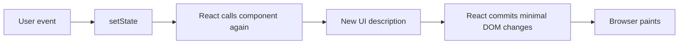

# 06 — React Foundations: Components, JSX, Props, State, Events, and Effects

## Aim

Learn React as a way to describe UI from data. Do not memorize hooks as magic commands. First understand the render model: UI is a function of props, state, and context.

The [official React rules](https://react.dev/reference/rules) require components and hooks to be pure during render, and [hooks must be called at the top level](https://react.dev/reference/rules/rules-of-hooks). These are not style preferences; React relies on them to match state with each component render.

## 1. Create a modern project

Vite is a common fast client-side starter:

```bash
npm create vite@latest task-board -- --template react
cd task-board
npm install
npm run dev
```

The generated project uses a development server, bundler, and JSX transformation. Read its `package.json` and `src` files. Do not manually add React through CDN scripts while learning modern application architecture; the tooling provides error overlays, hot reload, module support, and optimized production builds.

## 2. Declarative UI: describe, do not manually command

Imperative DOM code says: “find this element, change this text, disable this button.” React lets you say: “given `count`, this is what the UI looks like.” React calculates and commits the necessary DOM changes.



Keep a component render pure: same inputs should describe the same result. Do not fetch, mutate external objects, start timers, or update state during ordinary rendering. Use an event handler or effect for those side effects.

## 3. JSX: JavaScript syntax for UI descriptions

JSX looks like HTML but is JavaScript syntax that compiles to element descriptions. Component names begin with a capital letter; lowercase tags represent built-in HTML elements.

```jsx
function Welcome({ name, unreadCount }) {
  return (
    <section className="welcome">
      <h1>Hello, {name}</h1>
      <p>You have {unreadCount} unread messages.</p>
    </section>
  );
}
```

- `{name}` evaluates a JavaScript expression inside JSX.
- `className`, not `class`, is the usual JSX prop for CSS classes.
- JSX tags must be closed: ``, `<Task />`.
- Return one parent element, a fragment `<>...</>`, `null`, a string, or other renderable React child.
- Do not put statements such as `if` directly inside `{}`; compute a value first or use a conditional expression.

```jsx
function Status({ isOnline }) {
  const text = isOnline ? "Online" : "Offline";
  return <span>{text}</span>;
}
```

## 4. Components and props: one-way data flow

A component is a JavaScript function React calls to get UI. **Props** are inputs from a parent. Treat them as read-only; a child asks its parent for a change by calling a callback prop.

```jsx
function TaskItem({ task, onToggle }) {
  return (
    <li>
      <label>
        <input
          type="checkbox"
          checked={task.completed}
          onChange={() => onToggle(task.id)}
        />
        {task.title}
      </label>
    </li>
  );
}

function TaskList({ tasks, onToggle }) {
  return (
    <ul>
      {tasks.map((task) => (
        <TaskItem key={task.id} task={task} onToggle={onToggle} />
      ))}
    </ul>
  );
}
```

- `TaskList` maps data to one child per task.
- `key={task.id}` identifies this child among siblings over time. It is not passed as a normal prop.
- The parent owns the task collection. `TaskItem` receives data and reports an intent (`onToggle`).
- Never use an array index as a key when items can be inserted, deleted, sorted, or contain state. Stable identity prevents state moving to the wrong item.

## 5. State: a component’s memory

Use `useState` for data that changes over time and affects what the component renders. React gives you the current state for **this render** and a setter that requests a later render.

```jsx
import { useState } from "react";

export default function Counter() {
  const [count, setCount] = useState(0);

  function handleIncrease() {
    setCount((previousCount) => previousCount + 1);
  }

  return (
    <button type="button" onClick={handleIncrease}>
      Count: {count}
    </button>
  );
}
```

### Line by line

- `useState(0)` declares a state slot initialized to `0` for this component instance.
- `count` is a snapshot value for the current render.
- `setCount` schedules an update; it does not immediately change the current `count` variable.
- The updater form `(previousCount) => previousCount + 1` is safest when the next value depends on prior state, especially if React batches updates.
- `onClick={handleIncrease}` passes a function. Writing `onClick={handleIncrease()}` would run it during render, which is wrong.

React state must be replaced, not mutated. For objects/arrays make a new outer value:

```jsx
setTasks((previousTasks) =>
  previousTasks.map((task) =>
    task.id === id ? { ...task, completed: !task.completed } : task,
  ),
);
```

## 6. State design: minimal, local, and derived

Store the smallest truth from which the UI can be calculated. Do **not** store derived values such as `completedCount` if it can be calculated from `tasks` every render.

```jsx
const completedCount = tasks.filter((task) => task.completed).length;
```

When two components need the same state, lift it to their nearest common parent. When state grows tangled, use `useReducer` (next chapter). Do not reach for global state merely to avoid passing one or two props.

### State lives at a position in the tree

React preserves state when the same component type stays at the same position with the same key. Changing a key intentionally resets that subtree:

```jsx
<Chat key={selectedUser.id} user={selectedUser} />
```

Use this intentionally—for example, reset a form for a different record—not as a blanket fix.

## 7. Events and controlled forms

React event handlers receive a cross-browser event object. Put logic in functions, not string attributes. A **controlled input** gets its displayed value from state and reports changes through an event.

```jsx
function AddTaskForm({ onAdd }) {
  const [title, setTitle] = useState("");

  function handleSubmit(event) {
    event.preventDefault();
    const trimmedTitle = title.trim();
    if (!trimmedTitle) return;

    onAdd(trimmedTitle);
    setTitle("");
  }

  return (
    <form onSubmit={handleSubmit}>
      <label htmlFor="task-title">Task title</label>
      <input
        id="task-title"
        value={title}
        onChange={(event) => setTitle(event.target.value)}
      />
      <button>Add task</button>
    </form>
  );
}
```

- `onSubmit` supports click and Enter submission.
- `preventDefault()` stops the browser’s full page submit because this app handles it.
- `htmlFor` maps to HTML `for` because `for` is a JavaScript keyword.
- `value` + `onChange` keeps UI and state synchronized.
- `onAdd` is a parent callback; the child reports data but does not mutate parent state itself.

For simple uncontrolled forms or file inputs, `FormData` and refs may be better. Choose controlled inputs when validation, formatting, or interdependent fields must drive the UI.

## 8. Conditional rendering and lists

Use JavaScript conditions, not special React directives:

```jsx
function TaskPanel({ tasks, isLoading, error }) {
  if (isLoading) return <p>Loading tasks…</p>;
  if (error) return <p role="alert">Could not load tasks: {error.message}</p>;
  if (tasks.length === 0) return <p>No tasks yet. Add the first one.</p>;

  return <TaskList tasks={tasks} onToggle={() => {}} />;
}
```

Avoid `count && <Badge />` when `count` could be `0`, because React renders `0`. Use `count > 0 && <Badge />` or a ternary.

## 9. Effects: synchronize with outside React

`useEffect` is for synchronizing a rendered component with an external system: a network connection, browser API, subscription, timer, or non-React widget. The [official reference](https://react.dev/reference/react/useEffect) says that if no external system is involved, you probably do not need an effect.

```jsx
import { useEffect, useState } from "react";

function WindowWidth() {
  const [width, setWidth] = useState(window.innerWidth);

  useEffect(() => {
    function handleResize() {
      setWidth(window.innerWidth);
    }

    window.addEventListener("resize", handleResize);
    return () => window.removeEventListener("resize", handleResize);
  }, []);

  return <p>Window width: {width}px</p>;
}
```

The effect setup runs after React commits. Its cleanup reverses setup. In development Strict Mode, React may run setup → cleanup → setup once extra to expose missing cleanup; code should behave correctly under that test.

### Dependencies are not a preference list

Every reactive prop, state value, and locally declared function/object read by the effect belongs in the dependency list. The lint rule helps you enforce this. Instead of deleting a dependency to stop re-runs, restructure: move static values outside the component, calculate values during render, use an updater function, or split an unrelated effect.

Do not use an effect to derive display data from state:

```jsx
// Bad: extra render and easy to get out of sync
useEffect(() => setFullName(`${first} ${last}`), [first, last]);

// Good: calculate while rendering
const fullName = `${first} ${last}`;
```

## 10. Rules of Hooks and component purity

Call hooks only at the top level of React function components or custom hooks—never in a condition, loop, handler, nested callback, or after a possible early return. React identifies hook state by call order. The linter catches most violations.

```jsx
// Correct: the hook call happens every render in the same order.
function Profile({ user }) {
  const [expanded, setExpanded] = useState(false);
  if (!user) return null;
  return <button onClick={() => setExpanded(!expanded)}>{user.name}</button>;
}
```

Render must not mutate props or external values. Do impure work in event handlers or effects. This makes React’s rendering predictable and lets it optimize safely.

## Try it

1. Make a profile card component with props for `name`, `role`, and `avatarUrl`; render a list with stable keys.
2. Create an accordion that allows exactly one open panel. Decide where state belongs before writing code.
3. Build a controlled signup form with per-field errors and submit-state disabling.
4. Rewrite a component that uses `useEffect` to calculate `filteredItems` so it computes during render.
5. Write a `useDocumentTitle(title)` custom hook with setup/cleanup behavior. Explain each dependency.

Next: [07 — Advanced React](./07-react-advanced.md).
