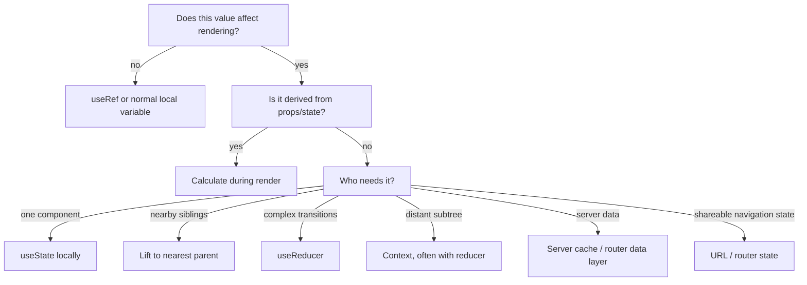

# 07 — Advanced React: State Architecture, Refs, Context, Reducers, Performance, and Modern APIs

## Aim

Learn to choose the smallest correct tool for state and synchronization. Advanced React is not a larger collection of hooks; it is disciplined data flow and measured performance work.

## 1. A state-location decision tree

Before adding state, ask what the value represents.



Do not copy props into state merely because they are props. If the UI should follow a prop, render from the prop. State is for data that changes independently over time.

## 2. `useReducer`: explicit transitions for complex state

Use a reducer when state updates are related, many event handlers update the same object, or you want transitions easy to test. A reducer is a pure `(state, action) => nextState` function.

```jsx
import { useReducer } from "react";

function taskReducer(tasks, action) {
  switch (action.type) {
    case "added":
      return [...tasks, { id: action.id, title: action.title, completed: false }];
    case "toggled":
      return tasks.map((task) =>
        task.id === action.id ? { ...task, completed: !task.completed } : task,
      );
    case "deleted":
      return tasks.filter((task) => task.id !== action.id);
    default:
      throw new Error(`Unknown action: ${action.type}`);
  }
}

function TaskBoard() {
  const [tasks, dispatch] = useReducer(taskReducer, []);

  function addTask(title) {
    dispatch({ type: "added", id: crypto.randomUUID(), title });
  }

  // render tasks and pass event handlers...
}
```

Actions are descriptions of **what happened**, not arbitrary setter instructions. `dispatch` is stable; the reducer must be pure and must not mutate its input. Test the reducer without rendering React at all.

## 3. Context: share an ambient dependency, not every value

Context allows a provider to make a value available to any descendant without threading props through every intermediate component. Good uses: theme, locale, authenticated session snapshot, routing, and a cohesive feature state. The [official guidance](https://react.dev/learn/passing-data-deeply-with-context) recommends trying props and composition first; explicit props make dependencies easy to see.

```jsx
import { createContext, useContext, useState } from "react";

const ThemeContext = createContext("light");

function App() {
  const [theme, setTheme] = useState("light");
  return (
    <ThemeContext value={theme}>
      <button onClick={() => setTheme(theme === "light" ? "dark" : "light")}>
        Toggle theme
      </button>
      <Page />
    </ThemeContext>
  );
}

function ThemeLabel() {
  const theme = useContext(ThemeContext);
  return <p>Current theme: {theme}</p>;
}
```

Every consumer re-renders when the provider receives a different value by `Object.is`. Keep provider values focused; split unrelated contexts. Do not use one giant `AppContext` as a hidden global dumping ground.

### Context plus reducer

For distant feature state, commonly provide `state` and `dispatch` through separate contexts. Separating them can avoid re-rendering a dispatch-only consumer when state changes.

## 4. Refs: persistent values that do not drive UI

`useRef` returns a stable object whose `.current` can change without a re-render. Use it for DOM nodes, timer IDs, connection objects, previous values, or an imperative escape hatch—not for data the screen needs to display.

```jsx
import { useRef } from "react";

function SearchBox() {
  const inputRef = useRef(null);

  function focusSearch() {
    inputRef.current?.focus();
  }

  return (
    <>
      <input ref={inputRef} type="search" aria-label="Search" />
      <button type="button" onClick={focusSearch}>Focus search</button>
    </>
  );
}
```

Reading/writing refs during render usually breaks purity. Set them in effects or event handlers. If changing a value should update the screen, choose state instead.

## 5. Custom hooks: reuse behavior, not UI hierarchy

A custom hook is a function beginning with `use` that calls other hooks and shares stateful logic. Each component that calls a hook gets its own state; custom hooks do not share state by themselves.

```jsx
import { useEffect, useState } from "react";

function useOnlineStatus() {
  const [isOnline, setIsOnline] = useState(navigator.onLine);

  useEffect(() => {
    const handleOnline = () => setIsOnline(true);
    const handleOffline = () => setIsOnline(false);
    window.addEventListener("online", handleOnline);
    window.addEventListener("offline", handleOffline);
    return () => {
      window.removeEventListener("online", handleOnline);
      window.removeEventListener("offline", handleOffline);
    };
  }, []);

  return isOnline;
}
```

The hook exposes a useful abstraction (“online status”) instead of leaking listeners. Name hooks for the behavior, not their internal implementation. Avoid making a custom hook solely to hide one line of `useState`.

## 6. Effects, stale closures, and dependency discipline

Every render creates new functions that close over that render’s props/state. If an effect, timer, or subscription uses old values because dependencies are omitted, that is a **stale closure**.

```jsx
// Correct: updates from the latest state, without reading count in this handler.
setCount((currentCount) => currentCount + 1);
```

For effects, put every reactive value read by setup/cleanup in dependencies. If an effect keeps rerunning, do not suppress the linter. Ask:

1. Is this really synchronization with an external system, or should it be calculated/rendered/event-driven?
2. Can I move a constant outside the component?
3. Can I put a helper inside the effect or extract it outside the component?
4. Can I use a state updater to avoid reading current state?
5. Should this be two separate effects with different dependencies?

Use `useLayoutEffect` only when you must measure/layout before the browser paints; it can block paint. `useInsertionEffect` is for CSS-in-JS library authors. Most app code needs neither.

## 7. Memoization: performance tool, not correctness tool

React re-renders a component when its state changes or when a parent renders. Most renders are cheap. First keep state local, avoid unnecessary effects, and profile a real slow interaction. Then use memoization when it demonstrably prevents expensive work.

```jsx
import { memo, useCallback, useMemo } from "react";

const SlowList = memo(function SlowList({ items, onChoose }) {
  return items.map((item) => (
    <button key={item.id} onClick={() => onChoose(item.id)}>{item.name}</button>
  ));
});

function Catalog({ products, query }) {
  const visibleProducts = useMemo(
    () => products.filter((product) => product.name.includes(query)),
    [products, query],
  );

  const handleChoose = useCallback((id) => {
    console.log(id);
  }, []);

  return <SlowList items={visibleProducts} onChoose={handleChoose} />;
}
```

- `memo` may skip a child render when its props are shallowly unchanged.
- `useMemo` caches a **calculated value** between renders.
- `useCallback` caches a **function identity** between renders.
- All dependency lists must be complete. Incorrect memoization creates stale bugs.
- A new `{}` / `[]` / `() => {}` prop each render defeats shallow comparison.

The official references describe `useMemo` and `useCallback` as performance optimizations; code must work without them. React Compiler can reduce manual memoization in supported projects, but understanding data flow remains essential.

## 8. Responsive updates: transitions and deferred values

Some updates are urgent (typing, clicking a button) and some are non-urgent (rendering a huge filtered result). `useTransition` marks non-urgent state updates so urgent updates stay responsive.

```jsx
import { useState, useTransition } from "react";

function SearchPage({ products }) {
  const [input, setInput] = useState("");
  const [query, setQuery] = useState("");
  const [isPending, startTransition] = useTransition();

  function handleChange(event) {
    const nextInput = event.target.value;
    setInput(nextInput); // urgent: input echoes immediately
    startTransition(() => setQuery(nextInput)); // non-urgent: list can lag
  }

  return <SearchUI input={input} query={query} isPending={isPending} products={products} onChange={handleChange} />;
}
```

`useDeferredValue(value)` is related: it lets a non-urgent consumer see a deferred version of a value. Neither API makes network requests faster; combine with sound fetching/caching and list virtualization for large data.

## 9. Lazy loading, Suspense, error boundaries

Load rarely visited code only when needed:

```jsx
import { lazy, Suspense } from "react";

const AdminPage = lazy(() => import("./AdminPage.jsx"));

function App() {
  return (
    <Suspense fallback={<p>Loading admin tools…</p>}>
      <AdminPage />
    </Suspense>
  );
}
```

`lazy` defers loading code, and `Suspense` supplies UI while it is unavailable. Add an error boundary around sections that may fail. Error boundaries traditionally use a class component or a trusted library; they catch rendering errors below them, not event-handler errors or arbitrary async failures. Handle those directly at their action boundary.

## 10. Modern form and resource APIs (learn after the core)

Modern React includes APIs such as `useActionState`, `useOptimistic`, `useTransition`, `use`, and form actions. Their best use often appears in a server-rendered React framework, where server functions and progressive enhancement are configured correctly. `useActionState` coordinates state returned by an action and exposes a pending flag; `useOptimistic` temporarily displays an expected result while a mutation is in flight.

Do not introduce optimistic UI casually: define a rollback path, keep IDs stable, show failures, and handle concurrent edits. For a normal client-side app, a mature data library or router data API is often simpler for caching, retries, invalidation, and mutations.

## 11. Class components: recognize, then prefer functions

Existing code may use `class Component`, `this.state`, `this.setState`, lifecycle methods, and `componentDidCatch`. Learn to read it. New React code generally uses function components and hooks because related logic can stay together in a custom hook. Do not mix lifecycle-to-hook conversions mechanically; translate the intent: rendering, event response, or external synchronization.

## Try it

1. Refactor a multi-field form from several `useState` values to a reducer. Unit-test reducer actions.
2. Implement theme context and explain why a page-specific `isModalOpen` does not belong there.
3. Make `useLocalStorageState(key, initialValue)` with JSON parsing, error fallback, and synchronization decisions documented.
4. Profile a long list; first reduce unnecessary state, then test `memo`/`useMemo` with a measurement.
5. Add an optimistic “complete task” interaction. Design how it rolls back when the API rejects.

Next: [08 — Production React](./08-react-production.md).
