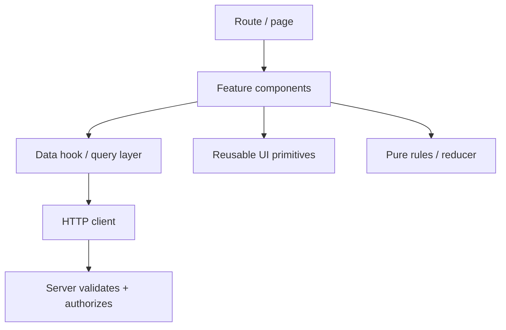
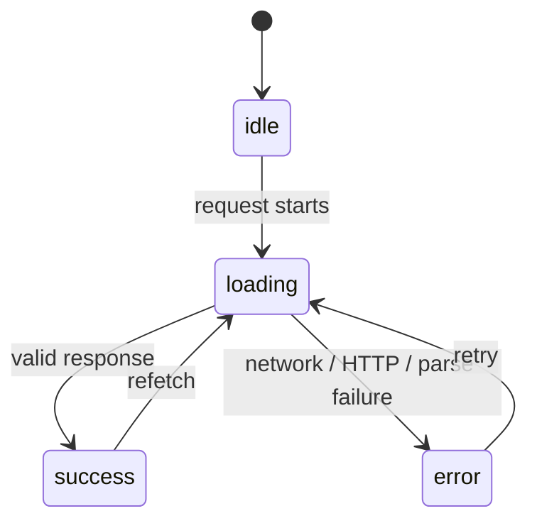

# 08 — Production React: Architecture, Routing, Data, Testing, Accessibility, Security, and Deployment

## Aim

Turn a component demo into an application people can use and maintain. Production quality is not one library; it is clear boundaries, accessible UI, reliable data flow, tests, observability, and secure server-side enforcement.

## 1. A practical application architecture

Organize by feature when the application grows. Keep feature-specific UI, API calls, tests, and logic together; keep truly shared primitives separate.

```text
src/
  app/                 # application providers, router, entry point
  features/
    tasks/
      api.js           # request functions / data contracts
      TaskList.jsx
      TaskForm.jsx
      taskReducer.js
      tasks.test.jsx
  components/          # reusable, domain-neutral UI primitives
  lib/                 # fetch client, validation, date utilities
  styles/
```

Do not create `components/`, `hooks/`, and `utils/` folders that contain unrelated business features with no ownership. A folder should help a developer answer “where does this change belong?”



## 2. Routing and URLs

Client routing maps URL paths to page components without a full document reload. Use a maintained router, rather than writing your own history handling. A route needs a page component, a not-found experience, loading/error behavior, and correct links.

Model user-visible navigable state in the URL:

- Path: `/tasks/abc123` identifies a resource.
- Query: `/tasks?status=open&page=2` identifies filter/pagination state.
- Hash: usually page-local location, not application state.

Use real links for navigation and buttons for actions. This preserves keyboard behavior, opening in a new tab, history, and accessibility. Validate route parameters just like any other external input.

### Client rendering, server rendering, and static generation

| Rendering mode | HTML initially made by | Strength | Tradeoff |
|---|---|---|---|
| CSR | browser after JS loads | simple client app | slower first meaningful view on weak networks |
| SSR | server per request | fast initial HTML, SEO | server complexity, hydration |
| SSG | build time | very fast static content | data may become stale |
| streaming/server components | server streams parts | flexible data/code boundaries | framework-specific mental model |

Choose a full-stack React framework when you need SSR, server components/actions, SEO-sensitive pages, or server-side data conventions. Choose a client-only Vite app for an internal dashboard or learning project where an API already exists. Framework choice is architecture, not fashion.

## 3. Server state is different from UI state

**UI/client state** belongs to the browser: modal open, current input text, selected tab, temporary draft. **Server state** is a cached view of data owned elsewhere: tasks, user profile, inventory. It can go stale, be invalidated by another device, fail to load, and require refetching.

For server state, choose either your router’s data APIs or a purpose-built caching library. The system should centrally handle:

- cache keys and request de-duplication,
- loading, error, empty, and stale states,
- retries appropriate to the operation,
- cancellation on navigation,
- mutation then invalidation/update,
- pagination/infinite lists,
- optimistic updates with rollback.

Do not make a global context full of fetched records and hand-written `useEffect` fetches by default. It often creates waterfalls, stale data, duplicate requests, and complex cache bugs.

### Fetching state machine



Show each state intentionally. “No tasks” is successful empty data, not a loading failure. For destructive or financial actions, explicit confirmation and accurate server result matter more than optimistic speed.

## 4. Data contracts and runtime validation

TypeScript can describe expected data, but network data is still untrusted at runtime. Validate at the API boundary using a schema/validator or careful functions, then let components receive a known shape.

```js
function parseTask(value) {
  if (
    !value ||
    typeof value !== "object" ||
    typeof value.id !== "string" ||
    typeof value.title !== "string" ||
    typeof value.completed !== "boolean"
  ) {
    throw new Error("API returned an invalid task");
  }
  return value;
}
```

Keep server response transformation close to the request, not scattered through components. The UI should not need six optional chains because the server response was never validated.

## 5. Testing React from the user’s viewpoint

Use a test runner such as Vitest and a DOM testing library. Test visible behavior and accessible roles, not component internals or private state. User-event tools simulate a realistic click/type sequence.

```jsx
import { render, screen } from "@testing-library/react";
import userEvent from "@testing-library/user-event";
import { expect, it } from "vitest";
import Counter from "./Counter.jsx";

it("increments after the user clicks", async () => {
  const user = userEvent.setup();
  render(<Counter />);

  await user.click(screen.getByRole("button", { name: /count: 0/i }));

  expect(screen.getByRole("button", { name: /count: 1/i })).toBeInTheDocument();
});
```

Use `getByRole` first because it reflects the accessibility tree. Mock the network at the HTTP boundary (for example with a service worker interceptor), not every internal hook. Add end-to-end tests for a few critical journeys: sign-in, a core mutation, payment boundary if applicable, and permission failure.

## 6. Accessibility is product quality

Build with semantic HTML first. Test with keyboard and a screen reader; automated checks help but cannot judge interaction design.

Checklist:

- Use headings in logical order, landmarks (`header`, `nav`, `main`, `footer`), `<button>` for actions, `<a>` for navigation.
- Every form control has a visible label and useful validation feedback.
- Keyboard focus is visible, follows a logical order, and is managed in dialogs/route changes when needed.
- Color is not the only signal; text, shape, or icon also conveys status.
- Text is readable at zoom; layout reflows; touch targets are usable.
- Dynamic status changes use appropriately restrained live regions, not constant announcements.
- Images have meaningful `alt` text or empty `alt=""` if decorative.
- A modal requires focus management, escape behavior, a labelled title, and a way to close it. Prefer a tested dialog primitive.

Accessibility must be designed into components, especially custom controls. A native element is usually safer than recreating it with `div` and ARIA.

## 7. Performance workflow

1. Define an interaction that feels slow with production-like data/device/network.
2. Measure with the browser Network/Performance panels and React DevTools Profiler.
3. Identify whether the bottleneck is download, server latency, rendering, JavaScript work, images, or layout.
4. Improve the actual bottleneck: split route code, optimize images, cache data, virtualize a large list, or simplify rendering.
5. Measure again. Keep only proven improvements.

Useful techniques:

- Route-level code splitting with `lazy` and `Suspense`.
- Image dimensions, responsive formats, lazy loading below the fold.
- Window/virtualize thousands of list rows rather than render all.
- Debounce network searches and cancel stale requests.
- Memoize only after profiling; see the advanced chapter.
- Avoid rendering huge hidden trees and expensive work inside render.

Core Web Vitals and user-perceived speed are outcomes; do not chase a single score at the expense of accessible, correct content.

## 8. Client-side security boundaries

React escapes text inserted into JSX by default. That helps against XSS, but risk returns if you use `dangerouslySetInnerHTML`, build URLs unsafely, or trust third-party content. Render untrusted text as text. If rich HTML is a requirement, use a well-reviewed sanitizer with a narrow allowed list and defense-in-depth headers.

The browser cannot be trusted to enforce permissions. A hidden admin button is only a UX choice; the API must verify identity and authorization on every request. Never put secrets in a React environment variable unless it is explicitly intended to be public. Use HTTPS and server-managed secure cookies/session architecture where appropriate.

## 9. Observability and failure design

Users see failures your local machine never sees: offline networks, old browsers, expired sessions, duplicate clicks, server timeouts, unexpected data. Plan for them.

- Add error boundaries around major page regions.
- Give async operations loading, failure, retry, and recovery UI.
- Log errors with release/version and safe contextual data; do not log secrets or sensitive fields.
- Track key product events with a privacy review.
- Monitor server health, error rate, latency, and failed jobs.
- Use feature flags for risky rollouts, with a rollback plan.

## 10. Build and deploy checklist

Before release:

- [ ] Run formatter, linter, type checker, unit/integration tests, production build.
- [ ] Test keyboard-only path, small viewport, zoom, slow network, and no-data/error cases.
- [ ] Verify routes, refresh/deep-link behavior, 404 page, page title, and meta data.
- [ ] Confirm environment variables/secrets are correctly scoped.
- [ ] Verify server authorization separately from UI visibility.
- [ ] Set cache headers and asset versioning deliberately.
- [ ] Test a production preview; development mode can hide timing and asset issues.
- [ ] Have monitoring, backups, migration plan, and rollback path for meaningful releases.

## Try it

1. Design URL routes and query parameters for a task app with filters and task detail pages.
2. Create an API client that parses every task response before returning it to UI.
3. Write tests for loading, successful empty data, a populated list, and a recoverable error.
4. Audit a form with only the keyboard: label, focus, error, submit, and result.
5. Profile 2,000 list rows, then implement virtualization or pagination and record before/after evidence.

Next: [09 — Labs and projects](./09-labs-and-projects.md).
