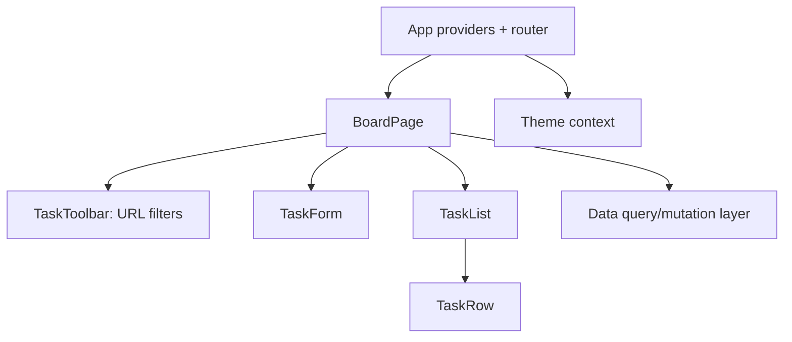

# 09 — Deliberate Practice Labs and Mastery Projects

## How to use labs

Do not read a solution immediately. Work in this order:

1. Restate the goal, inputs, outputs, constraints, and edge cases.
2. Make three test examples on paper, including an empty/boundary/error case.
3. Build the smallest working version.
4. Test manually, then add automated tests where the lab requests them.
5. Refactor only after behavior is correct.
6. Write a short retrospective: bug found, why it happened, and what you will check next time.

Use this quality ladder: **works → handles edge cases → readable → tested → accessible → measured → documented**.

## Lab 1 — Values, variables, and conversion

**Goal:** Write a tip calculator function.

- Input: bill amount and a percent.
- Output: `{ tip, total }` rounded to two decimals.
- Reject negative/non-finite values.
- Test `0`, a decimal bill, `NaN`, and a string input.

**Mastery check:** Explain why `Number(" ")` and `Number("hello")` behave differently.

## Lab 2 — Conditionals: grade report

Write `buildGradeReport(score, attendance)`.

- Score must be 0–100, attendance 0–100.
- Give A/B/C/D/F by score.
- A student with attendance below 75 has status `"incomplete"` regardless of grade.
- Return an object; do not log from the function.

**Stretch:** create a table-driven test array instead of separate repeated tests.

## Lab 3 — Loops and patterns

Implement `fizzBuzz(limit)` returning an array. For multiples of 3 use `Fizz`, 5 use `Buzz`, both use `FizzBuzz`, otherwise the number. Validate `limit` as a positive integer. Then implement it without `else if` by carefully composing conditions.

## Lab 4 — Strings and regular expressions

Build `normalizePhoneNumber(text)` for a single agreed input format. Return a canonical digits-only string or `null`. Document what formats you accept; do not pretend a simple regex validates every global phone number.

## Lab 5 — Array transformation pipeline

Given an array of orders, calculate revenue by category.

```js
const orders = [
  { category: "books", unitPrice: 499, quantity: 2, paid: true },
  { category: "games", unitPrice: 999, quantity: 1, paid: false },
  { category: "books", unitPrice: 299, quantity: 3, paid: true },
];
```

Return `{ books: 1895 }` in rupees. Decide whether to use `reduce` or a `for...of` loop, and explain why.

## Lab 6 — Immutable todo transformations

Write pure functions: `addTodo`, `toggleTodo`, `renameTodo`, `deleteTodo`. None may mutate the input array/object. Test original identity and changed identity with `Object.is`.

## Lab 7 — Object modeling

Model a library book loan. Include a `Book` value, a `Member` value, and pure functions for borrow/return. Define explicit behavior for already borrowed and unknown IDs. Do not use a class unless you can explain why it makes the design simpler.

## Lab 8 — Closures

Create `createRateLimiter(limit)` that returns `allow()`. It returns `true` the first `limit` calls and `false` afterwards. Write a second independent limiter. Draw the two separate closure environments.

## Lab 9 — `this` clinic

Make an object with a normal method and an arrow function. Call them as methods, detach them, then use `bind`. Predict `this` before running. Write a paragraph explaining call-site binding.

## Lab 10 — Classes and composition

Create an `InventoryItem` class with validated stock changes and a private stock field. Then redesign with a plain data object plus `addStock(item, amount)`. Compare testability, serialization, and when class methods help.

## Lab 11 — DOM counter without a framework

Build an accessible counter with min/max, reset, disabled buttons, and `aria-live="polite"` status. Keep `count` as the source of truth and have exactly one `render` function.

## Lab 12 — DOM list and event delegation

Build a shopping list. Add items with a form; mark purchased; delete by a delegated listener on the list. Use `textContent`, not untrusted `innerHTML`. Test that clicking an icon inside the delete button still finds the button.

## Lab 13 — Form validation

Build a registration form with email, password confirmation, and terms checkbox.

- Use native constraints first.
- Add JavaScript for cross-field password matching.
- Keep the error next to the relevant field.
- On submit, focus the first invalid input.
- Never log the password.

## Lab 14 — Clock and timer hygiene

Build a digital clock and a start/pause/reset stopwatch. Make sure clicking start repeatedly never creates multiple intervals. Clear every timer when it is no longer needed.

## Lab 15 — Async sequencing

Implement `runSteps(steps)` where each `step` returns a promise. Run them in order, stop on the first error, and return a useful result. Then implement an independent parallel version with `Promise.all` and compare timing.

## Lab 16 — Fetch state machine

Use a public learning API or a local mocked endpoint. Render all states: idle, loading, success with data, successful empty data, failure, retry. Check `response.ok`, catch errors, and cancel in-flight requests when a new query begins.

## Lab 17 — Persistent preferences

Build a theme chooser. Persist only `"light"`, `"dark"`, or `"system"`; reject corrupt localStorage values. Respect system preference for the system option. Explain why this is not a place for auth tokens.

## Lab 18 — Node CLI

Write a Node script that reads a JSON file, validates a list of tasks, and prints a summary. Use `node:fs/promises`, `node:path`, and correct error codes. Do not overwrite input data.

## Lab 19 — Modules and tests

Split a cart calculator into modules. Add test cases for empty cart, zero quantity, negative price, decimal rounding, and discount boundary. Add `test`, `lint`, and `format` scripts.

## Lab 20 — Express task API

Create a small API with `GET /tasks`, `POST /tasks`, `PATCH /tasks/:id`, and `DELETE /tasks/:id`.

- Validate each body.
- Use correct 400/404/201 status outcomes.
- Add centralized error middleware.
- Test routes as HTTP behavior.
- Explain why in-memory data disappears on restart.

## Lab 21 — First React component tree

Make a product catalog from a provided array. Break it into `Catalog`, `ProductGrid`, `ProductCard`, and `Price`. Pass props only; no state. Add stable keys and semantic headings.

## Lab 22 — Controlled React form

Build `AddTaskForm` with title input, inline validation, disabled submit when invalid, and reset after successful add. Use `onSubmit`, not only button click. Explain controlled versus uncontrolled input.

## Lab 23 — Lift state up

Build an accordion where exactly one panel may be open. Start with local state in each panel, observe the bug, then move `activeId` to the parent. Draw the one-way data flow.

## Lab 24 — Reducer task board

Move a task board’s add/toggle/delete/edit transitions into a reducer. Use action names in past tense, unit-test the reducer, and refuse unknown actions. Keep generated IDs outside the reducer if you want a pure reducer.

## Lab 25 — Context without a global mess

Make ThemeContext and UserContext. Keep a `selectedTaskId` local to the task feature. Verify through React DevTools which components re-render on theme change. Split a context if unrelated consumers wake up unnecessarily.

## Lab 26 — Effect lifecycle

Make a `useOnlineStatus` custom hook. Test mount, change, unmount cleanup. Enable Strict Mode and make sure duplicate listener bugs do not appear.

## Lab 27 — Server data

Connect a React list to your task API. Define client states and an error/retry path. Cancel stale searches. Then adopt either router loaders/data APIs or a server-cache library; compare the amount of hand-written cache logic.

## Lab 28 — Performance evidence

Create a deliberately expensive 1,000-row list. Profile it. First isolate state; only then try `memo`, `useMemo`, or virtualization. Record what actually improved and what did not.

## Lab 29 — Accessibility audit

Audit a previous project with keyboard only, 200% zoom, reduced motion, and a screen reader if available. Fix at least five real findings. Create a before/after issue list.

## Lab 30 — Production polish

Add routing, a 404 page, document titles, empty/loading/error states, code splitting for a route, error boundary placement, test coverage for key workflow, and a deploy checklist.

# Projects

## Project A — Vanilla JavaScript Personal Dashboard

**Goal:** prove you understand the browser before React hides DOM mechanics.

Features:

- Todo list with add/edit/complete/delete/filter.
- Theme preference persisted safely.
- Current time and a focus timer with clean timer lifecycle.
- A weather/news-like API panel with loading, retry, cancellation, and empty/error states.
- Accessibility: semantic navigation, labels, focus states, keyboard operation.

Suggested order: data model → pure transformations → static HTML → render function → event handlers → persistence → API panel → tests/refactoring → accessibility audit.

**Definition of done:** refresh does not lose local tasks; invalid user text never becomes HTML; no duplicate listeners/timers; app works with keyboard; network failure is understandable.

## Project B — React Task Board

**Goal:** use React’s core state architecture well.

Features:

- Routes: board list, board detail, settings, not-found.
- Reducer-powered tasks, filters in URL query parameters, theme context.
- Controlled form with validation and a focused error.
- API data layer with caching, mutation state, retry, and stale-request protection.
- Optimistic completion with rollback notification.
- Tests for reducer, form behavior, and a critical journey.

Suggested component sketch:



## Capstone — Team Workflow Application

Build a production-style application with a React frontend, an authenticated server API, database persistence, and deployment.

### Required flows

1. Sign in/out and restore session safely.
2. Create a workspace/project; invite/assign roles.
3. Create, edit, complete, and filter tasks.
4. Enforce permissions on the server (member cannot perform admin action).
5. Show audit-friendly timestamps and clear errors.
6. Work well on mobile, keyboard, and slow networks.

### Engineering requirements

- Architecture diagram and data model diagram.
- API contract with validation and error responses.
- Server authorization tests.
- Client component/unit tests and end-to-end tests for critical workflow.
- Loading, empty, error, offline/slow, and destructive-confirmation UX.
- Basic logging/monitoring plan; deployment/rollback README.
- Security review: secrets, authorization, input rendering, rate limits, dependency audit.
- Performance before/after measurement for one real bottleneck.

### Capstone review rubric (100 points)

| Area | Points | Evidence |
|---|---:|---|
| Correct JavaScript/data modeling | 15 | pure functions, immutable updates, edge cases |
| React architecture | 15 | sensible state placement, component boundaries |
| API/server correctness | 15 | validation, status codes, authorization |
| UX and accessibility | 15 | keyboard, labels, focus, all async states |
| Tests and debugging | 15 | meaningful automated and manual evidence |
| Security and privacy | 10 | threat notes, no exposed secrets, server enforcement |
| Performance/reliability | 10 | measured improvement, error/retry/rollback paths |
| Documentation | 5 | setup, decisions, constraints, next improvements |

## When you are genuinely ready for interviews

You can take an unfamiliar requirement and: clarify inputs/constraints; choose state location; write a small pure function; explain closure/object identity/event loop behavior; build accessible UI; call an API with errors handled; test essential behavior; and articulate tradeoffs without calling every tool a best practice. The next file gives recall drills and a coverage map.

Next: [10 — Reference and interview preparation](./10-reference-and-interview.md).
