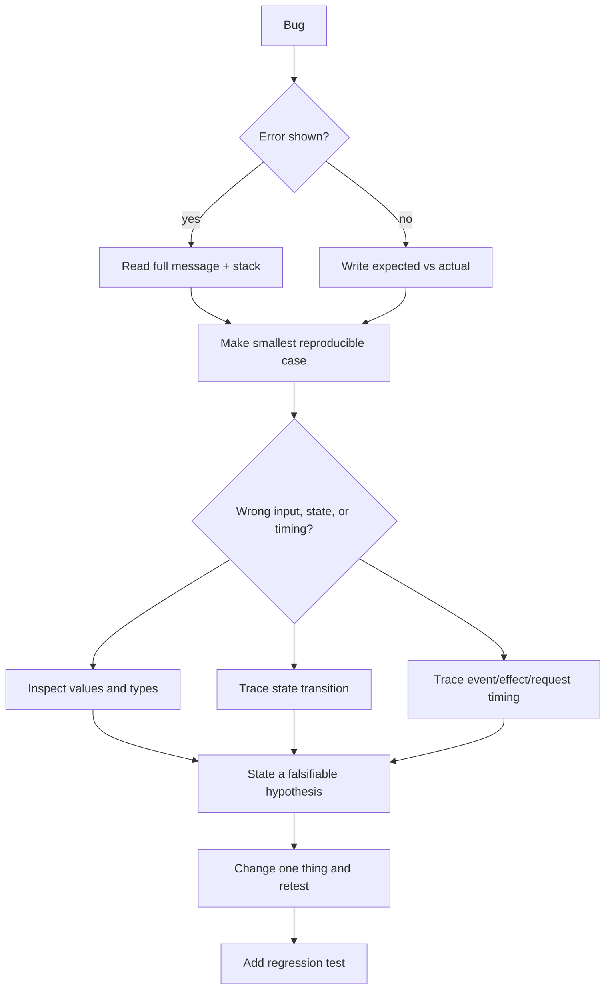

# 10 — Reference, Coverage Map, Debugging, and Interview Drills

## JavaScript coverage map

Use this as a checklist, not as a substitute for the explanations and labs.

| Area | Core concepts covered | Go deeper when needed |
|---|---|---|
| Syntax | expressions/statements, strict mode, comments, semicolons, template literals | decorators and upcoming proposals |
| Values | primitives, objects, equality, truthiness, coercion, `NaN`, number precision, BigInt, symbols | internationalization edge cases |
| Variables/scope | `const`, `let`, `var`, block/function/module scope, TDZ, hoisting | direct `eval` (avoid) |
| Flow | if/switch, guard clauses, loops, short-circuiting, optional chaining, nullish coalescing | labelled statements (rare) |
| Functions | declarations/expressions/arrows, parameters, defaults, rest, spread, recursion, pure functions | currying, partial application, tail-call theory |
| Arrays | indexing, mutation, map/filter/reduce/find/some/every, sort, iterators | typed arrays for binary numeric data |
| Strings | immutable strings, search/slice/replace/split, template literals | Unicode grapheme segmentation |
| Objects | properties, descriptors concept, prototypes, copy/update, destructuring, JSON | `Proxy`/`Reflect`, property descriptor APIs |
| Collections | object, `Map`, `Set`, `WeakMap`, `WeakSet` | garbage-collection-sensitive metadata |
| OOP | `this`, `call/apply/bind`, constructors, classes, private fields, inheritance, `instanceof` | mixins and metaprogramming |
| Errors | throw, Error subclasses, try/catch/finally, validation | error reporting/observability systems |
| Async | callbacks, promises, `async`/`await`, concurrency helpers, event loop, cancellation | Web Workers, streams, async iterators |
| Browser | DOM traversal/mutation, events, forms, timers, URL, storage, fetch, cookies | Web Components, service workers, IndexedDB |
| Node | npm, package.json, ESM/CommonJS, HTTP/Express, env, files | streams, workers, child processes, clusters |
| Quality | tests, lint, format, JSDoc/TypeScript, security, performance | CI/CD, observability, architecture patterns |
| Pattern matching | regular expressions and test cases | parsing with a grammar/parser |

## React coverage map

| Area | Core concepts covered | Go deeper when needed |
|---|---|---|
| Mental model | declarative UI, render/commit, purity, one-way data flow | concurrent rendering internals |
| Components/JSX | component composition, props, children, lists, keys, conditions | compound components / slots |
| State | `useState`, immutable updates, state snapshots, derived state, reset with key | state machines for complex workflows |
| Events/forms | handlers, controlled/uncontrolled inputs, form submit, validation | form libraries for very large forms |
| Effects | external synchronization, cleanup, dependencies, stale closure | `useEffectEvent`, layout/insertion effects |
| Shared state | lifting state, context, reducer/context | external state libraries only with need |
| Hooks | `useRef`, `useReducer`, `useContext`, custom hooks | `useImperativeHandle`, `useSyncExternalStore` |
| Performance | profiler, `memo`, `useMemo`, `useCallback`, transitions, deferred values, lazy/Suspense | React Compiler, virtualization tuning |
| Modern React | actions, optimistic UI, `use`, server-rendered framework concepts | Server Components and framework-specific APIs |
| App engineering | routing, server cache, data contracts, error boundaries, tests, a11y, security, deployment | React Native, animation, design systems |

## High-value JavaScript API reference

### Arrays

| Need | API | Mutates? |
|---|---|---:|
| append/remove end | `push`, `pop` | yes |
| add/remove anywhere | `splice` | yes |
| copy range | `slice` | no |
| transform each | `map` | no |
| keep matching | `filter` | no |
| first matching value/index | `find`, `findIndex` | no |
| test any/all | `some`, `every` | no |
| one accumulated output | `reduce` | no |
| sort safely | `toSorted(compare)` | no |
| reverse safely | `toReversed()` | no |
| replace item safely | `with(index, value)` | no |

### Objects and values

| Need | API/pattern |
|---|---|
| own keys/values/entries | `Object.keys`, `Object.values`, `Object.entries` |
| build object from pairs | `Object.fromEntries` |
| shallow copy/update | `{ ...object, field: value }` |
| safe nested access | `object?.a?.b` |
| null/undefined default only | `value ?? fallback` |
| optional dynamic field | `object?.[key]` |
| fixed locale number/date | `Intl.NumberFormat`, `Intl.DateTimeFormat` |
| own-property test | `Object.hasOwn(object, key)` |

### Functions and async

| Need | API/pattern |
|---|---|
| unknown number of arguments | rest `(...items)` |
| call with array args | `fn(...args)` |
| change `this` once | `fn.call(obj, a)`, `fn.apply(obj, args)` |
| permanently bind `this` | `fn.bind(obj)` |
| all requests required | `await Promise.all([...])` |
| inspect all request outcomes | `await Promise.allSettled([...])` |
| cancel fetch/listeners | `AbortController` + `signal` |
| wait after quiet input | debounce |
| limit rate | throttle |

## Debugging decision tree

### Common JavaScript bugs

- `Cannot read properties of undefined`: your assumed shape is absent. Inspect at the boundary; validate/guard.
- `x is not a function`: check the value and spelling; you may have overwritten it or accessed wrong property.
- `undefined` result: a function has no return on some path or a callback forgot `return`.
- Async order issue: await the correct promise; do not expect later work to finish synchronously.
- Unexpected shared change: you mutated an object/array referenced elsewhere.
- Loop wrong behavior: print index/value; check inclusive/exclusive boundary and mutation during iteration.

### Common React bugs

- “Too many re-renders”: state setter runs during render. Pass a handler function instead.
- State did not update immediately: you are reading the old render snapshot. Use the next render or updater form.
- List item state moved: use stable data IDs as keys, not changing indices.
- Effect loop: effect updates a dependency every time. Reconsider whether an effect is needed.
- Effect reads old value: dependency is missing or you need a ref/updater/restructured effect.
- Child re-renders unexpectedly: first inspect state placement and props; memoize only after evidence.
- Context consumer updates too widely: split provider value or context by concern.

## Interview drills — explain aloud before coding

### JavaScript

1. Explain primitive copy versus object reference using a nested object example.
2. What is a closure? Build a private counter with one.
3. What is `this` in a normal method, a detached function, and an arrow function?
4. Predict promise/microtask/timer output and explain the event loop.
5. Compare `map`, `forEach`, `filter`, and `reduce` by intent.
6. Explain shallow copy and implement a nested immutable update.
7. What does `fetch` reject for? Why must you check `response.ok`?
8. Compare `localStorage`, cookie sessions, and server database persistence.
9. What is a module boundary and why do circular imports hurt?
10. How would you diagnose a slow page without guessing?

### React

1. Explain render, commit, browser paint, and why render must be pure.
2. Why does calling a hook conditionally fail?
3. Explain state as a snapshot; why can two `setCount(count + 1)` calls surprise beginners?
4. Where would you put state shared by two siblings? What about an app-wide theme? Server records?
5. When is `useEffect` appropriate, and what does cleanup do?
6. Why are index keys risky? Give a concrete inserted-item bug.
7. Compare state, ref, context, reducer, URL state, and server cache.
8. What do `useMemo`, `useCallback`, and `memo` cache? Why are they not default tools?
9. How do you test a form using accessible queries?
10. How do client-side authorization and server-side authorization differ?

## Coding-problem procedure

1. Ask constraints: input size, invalid input, mutability, complexity, environment.
2. Say a simple approach and its complexity.
3. Work a concrete sample out loud.
4. Write readable code with names that expose intent.
5. Test empty, one, many, boundary, duplicate, and invalid cases.
6. Improve only if constraints require it; explain the tradeoff.

## Specialist map: choose after the core

| Interest | Next topics |
|---|---|
| Frontend platform | service workers/PWA, Web Components, Web Workers, IndexedDB, performance API |
| Full stack | database design, auth, queues/jobs, caching, API versioning, observability |
| React framework | SSR/RSC, route loaders, server actions, streaming, deployment adapters |
| Mobile | React Native, platform navigation, native modules, offline synchronization |
| Visual/data | Canvas, SVG, WebGL/WebGPU, D3, accessibility of visualizations |
| Backend/Node | streams, worker threads, message queues, containers, distributed systems |
| Security | OWASP Top 10, CSP, OAuth/OIDC, sessions, threat modeling, secure SDLC |
| Language depth | TypeScript, compilers/parsers, ASTs, engine optimization, ECMAScript proposals |

## Official resources for keeping current

- [React documentation](https://react.dev/learn)
- [MDN JavaScript guide](https://developer.mozilla.org/en-US/docs/Web/JavaScript/Guide)
- [MDN Web APIs](https://developer.mozilla.org/en-US/docs/Web/API)
- [Node.js documentation](https://nodejs.org/docs/latest/api/)
- [ECMAScript specification](https://tc39.es/ecma262/) — reference, not first tutorial

Return to [the main handbook](./README.md) and mark the tracker only after you can demonstrate each skill.
