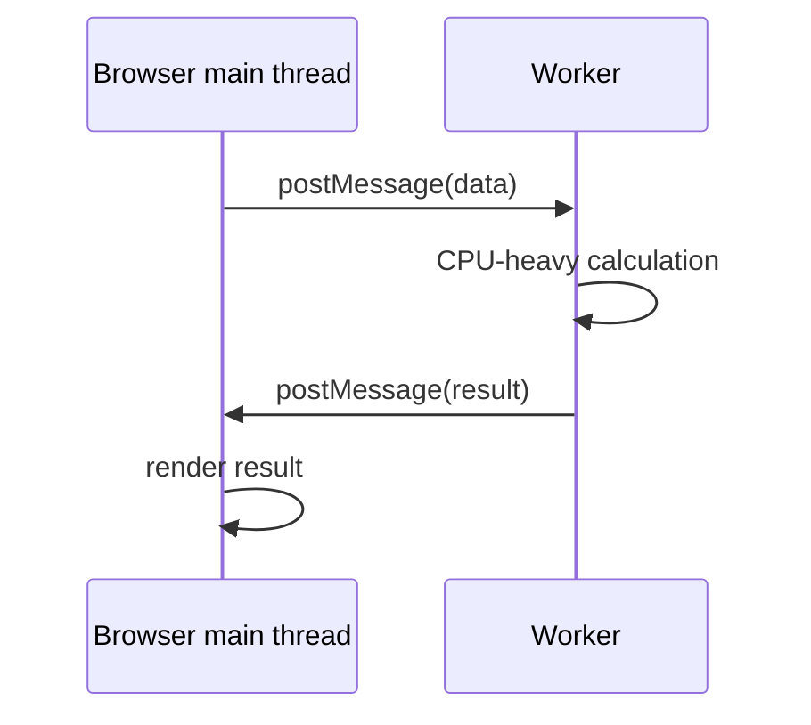

# 12 — Advanced JavaScript Atlas: Language Depth and Platform Boundaries

## Aim

This chapter covers powerful but less everyday JavaScript features. Do not use a feature because it is advanced. Use it when it makes a clearly stated problem simpler, safer, or faster.

## 1. Property descriptors, getters, setters, and object integrity

Every property has a descriptor: data properties have `value`/`writable`; accessor properties have `get`/`set`; both can be `enumerable` and `configurable`.

```js
const settings = {};

Object.defineProperty(settings, "version", {
  value: 1,
  writable: false,
  enumerable: true,
  configurable: false,
});

console.log(Object.getOwnPropertyDescriptor(settings, "version"));
```

Class getters/setters are prototype accessor properties. Use them to guard an invariant, not to hide surprising expensive/network work behind what looks like a field.

```js
const range = {
  _start: 0,
  get start() { return this._start; },
  set start(value) {
    if (!Number.isFinite(value)) throw new TypeError("start must be finite");
    this._start = value;
  },
};
```

`Object.preventExtensions` stops new properties; `Object.seal` also makes existing property configuration fixed; `Object.freeze` additionally makes own data properties non-writable. All are shallow. They do not make nested objects immutable, and freezing is not a replacement for API design.

## 2. Prototype operations, `Object.create`, and composition

`Object.create(prototype)` makes an object with an explicit prototype. `Object.getPrototypeOf` inspects an object’s inheritance link. Avoid modifying built-in prototypes in applications; it affects unrelated code.

```js
const canFly = {
  fly() { return `${this.name} flies`; },
};

const bird = Object.create(canFly);
bird.name = "Swift";
console.log(bird.fly());
```

This shows delegation. In most applications, prefer plain objects, functions, and composition to a large inheritance hierarchy. A mixin-like composition can be explicit:

```js
const withTimestamps = (value) => ({
  ...value,
  createdAt: new Date().toISOString(),
});
```

## 3. Symbols and well-known protocols

Symbols create collision-resistant property keys. They are not security: code that has the symbol can access the property. JavaScript also uses well-known symbols to support protocols such as iteration.

```js
const iterableRange = {
  start: 1,
  end: 3,
  *[Symbol.iterator]() {
    for (let value = this.start; value <= this.end; value += 1) {
      yield value;
    }
  },
};

console.log([...iterableRange]); // [1, 2, 3]
```

`for...of`, spread, `Array.from`, and destructuring consume iterables. `for await...of` consumes an **async iterable**, which yields promised values over time.

## 4. Generators and async generators

Generators pause at `yield`; their caller controls when the next value is requested. Async generators use `async function*` and can await between yielded values.

```js
async function* pagedItems(fetchPage) {
  let page = 1;
  while (true) {
    const result = await fetchPage(page);
    yield* result.items;
    if (!result.nextPage) return;
    page = result.nextPage;
  }
}

for await (const item of pagedItems(fetchPage)) {
  console.log(item);
}
```

They are useful for streaming/paginated abstractions. Do not introduce them for a simple array transformation.

## 5. `Proxy` and `Reflect`

A `Proxy` intercepts operations on a target object; `Reflect` provides the default operation implementations. Frameworks and validation libraries may use these. They are powerful enough to make debugging and performance worse.

```js
const required = new Proxy({}, {
  get(target, property, receiver) {
    if (!Reflect.has(target, property)) {
      throw new Error(`Missing setting: ${String(property)}`);
    }
    return Reflect.get(target, property, receiver);
  },
});

required.apiUrl = "https://example.test";
console.log(required.apiUrl);
```

Avoid proxying public application data unless you can document every trap, preserve language invariants, and test unusual operations such as enumeration and `in`.

## 6. Memory and garbage collection

JavaScript engines reclaim objects that are no longer reachable from roots such as global variables, active call stacks, and live closures. You cannot reliably force garbage collection. You *can* avoid holding references longer than necessary.

Common leaks:

- event listeners/subscriptions never cleaned up;
- timers/intervals still referencing component data;
- detached DOM nodes retained by arrays or closures;
- unbounded caches;
- global state that accumulates every response.

`WeakMap`/`WeakSet` hold object keys weakly, so they are suitable for metadata that should not keep an object alive. They are not iterable by design; if you need to list all keys, use `Map` and manage lifetime yourself.

## 7. Structured cloning, transfer, and workers

`structuredClone(value)` deeply clones many web-compatible data types, supports cycles, and is safer/more capable than JSON for many data structures. It cannot clone functions, DOM nodes, or certain host objects.

```js
const original = { when: new Date(), tags: new Set(["js"]) };
const copy = structuredClone(original);
```

Web Workers run JavaScript away from the browser main thread. Use them for heavy CPU work—parsing a huge file, image processing, a complex calculation—not ordinary `fetch`, which is already asynchronous.



Messages use structured cloning, except transferable objects such as `ArrayBuffer` can move ownership for speed. Design a cancellation/progress/error protocol; a worker does not automatically solve coordination.

## 8. Web streams and binary data

`ReadableStream`, `WritableStream`, and `TransformStream` process chunks without storing an entire large resource in memory. Fetch response bodies expose a stream. `Blob`, `File`, `ArrayBuffer`, `DataView`, and typed arrays (`Uint8Array`, etc.) represent binary data.

Choose the right level:

- `Blob`/`File`: browser file-like bytes, often for upload/download.
- `ArrayBuffer`: raw fixed-size bytes.
- Typed array: a typed view of an array buffer.
- `DataView`: read/write varied binary layout.
- Stream: a sequence of chunks over time.

These are specialist tools for media, files, protocols, and large data. Validate size/type and never trust a client-provided file extension.

## 9. Browser scheduling and observation APIs

- `requestAnimationFrame`: before next paint; visual animation/layout work.
- `requestIdleCallback`: low-priority best-effort work (not universal/reliable for required work).
- `IntersectionObserver`: know when element enters viewport; lazy loading/infinite list trigger.
- `ResizeObserver`: observe element size changes; charts/component layout.
- `MutationObserver`: observe DOM mutation; integrate with non-React DOM code cautiously.
- `PerformanceObserver`: observe performance entries; diagnostics.

Avoid expensive layout reads/writes interleaved in a loop; batch reads, then writes to reduce layout thrashing.

## 10. Web storage and offline platform

`localStorage` is synchronous string storage. IndexedDB is an asynchronous transactional database in the browser. Cache Storage stores request/response pairs, often used by service workers. A service worker is a separate event-driven script that can intercept requests, cache resources, and support offline behavior.

Offline apps are a full consistency problem: cache versioning, failed writes, retries, conflict resolution, user messaging, and security. Learn it after ordinary online behavior and server data correctness are solid.

## 11. Web Components and custom elements

Web Components are browser-standard reusable elements: custom elements, Shadow DOM, HTML templates, and slots. They can coexist with React, but events/properties and lifecycle integration need care. Choose them for cross-framework/distribution needs; choose React components for a React-only product. Shadow DOM provides style encapsulation, not automatic security.

## 12. Functional patterns that help

- **Immutability:** return new data rather than change shared data.
- **Referential transparency:** an expression can be replaced by its result without changing behavior.
- **Higher-order function:** takes/returns functions, for example `map` or `debounce`.
- **Composition:** build behavior from small pieces. Prefer clarity over clever chains.
- **Idempotence:** repeating an operation has same effect as doing it once; important for retries.

Example composition:

```js
const pipe = (...functions) => (value) =>
  functions.reduce((current, fn) => fn(current), value);

const normalizeName = pipe(
  (text) => text.trim(),
  (text) => text.replace(/\s+/g, " "),
  (text) => text.toLowerCase(),
);
```

This is useful only while the team can read it easily. Three named intermediate variables are often better.

## Study prompts

1. Build an iterable `Range` and demonstrate spread/destructuring.
2. Use `structuredClone` on nested data with Date/Map; compare it with JSON cloning.
3. Move a CPU-heavy prime calculation to a Worker with progress/error messages.
4. Use `IntersectionObserver` to lazy-load images while preserving width/height and alt text.
5. Explain why a `WeakMap` cannot be used to list all cache entries.

Return to [the reference map](./10-reference-and-interview.md) when choosing your next specialization.
