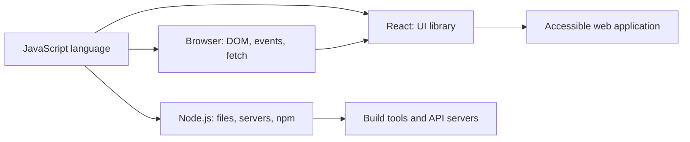
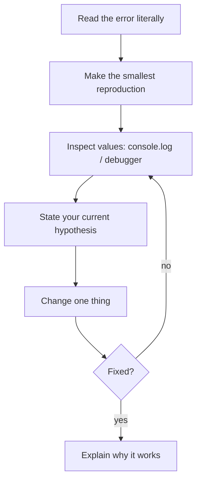

# JavaScript + React Mastery Handbook

## What this is

This is a practical path from your first `console.log` to designing, testing, and shipping React applications. It is written in simple English, but it does not hide the hard ideas. Read a chapter, type every example yourself, predict its output, then complete the related lab before moving on.

JavaScript is the language. The browser and Node.js are environments that run it. React is a library that uses JavaScript to describe user interfaces. Keeping those three layers separate is the first important mental model.

## Your route

| Phase | Read | Main outcome |
|---|---|---|
| 0 | [Learning system](./00-learning-system.md) | Set up a repeatable practice routine |
| 1 | [JavaScript foundations](./01-javascript-foundations.md) | Think in values, variables, conditions, loops, functions |
| 2 | [Data, objects, and functions](./02-data-functions-objects.md) | Work safely with arrays, objects, scope, `this`, prototypes, classes |
| 3 | [Browser and DOM](./03-browser-dom-events.md) | Make interactive web pages without a framework |
| 4 | [Asynchronous JavaScript](./04-async-network-storage.md) | Understand the event loop, promises, APIs, errors, storage |
| 5 | [Professional JavaScript](./05-node-modules-quality.md) | Use Node, npm, modules, tests, security, performance |
| 6 | [React foundations](./06-react-foundations.md) | Build components with JSX, props, state, effects, forms |
| 7 | [React advanced](./07-react-advanced.md) | Manage complex state, performance, refs, context, custom hooks |
| 8 | [Production React](./08-react-production.md) | Route, fetch data, test, secure, deploy, and design accessibly |
| 9 | [Labs and projects](./09-labs-and-projects.md) | Prove skills through deliberate practice |
| 10 | [Reference sheets](./10-reference-and-interview.md) | Recall patterns, debug quickly, prepare for interviews |
| 11 | [Worked React task board](./11-worked-react-task-board.md) | Read a complete small React feature file by file |
| 12 | [Advanced JavaScript atlas](./12-advanced-javascript-atlas.md) | Learn the less-common language and platform tools deliberately |
| 13 | [React API atlas](./13-react-api-atlas.md) | Choose React hooks and APIs by the problem they solve |

## How to study a chapter

1. Read the **aim** first. It tells you what problem the concept solves.
2. Type, do not paste, every code block. Change one thing and observe what changes.
3. Before running code, write down the expected output. A wrong prediction is useful feedback.
4. Read the line-by-line explanation after you have made a prediction.
5. Complete the “Try it” tasks with no notes open on the second attempt.
6. Save your solutions in one Git repository. Commit when a lab is complete.

Use this loop whenever stuck:

## Coverage promise and honest boundary

No finite document can contain every future browser API, library, or proposal. This handbook covers the durable core of ECMAScript, browser JavaScript, Node development, and modern React workflows; it also gives a method for learning APIs you have never seen. The reference chapter lists related topics that are intentionally specialized: WebGL, WebRTC, Web Audio, service workers, Web Components, server-side React frameworks, React Native, and compiler-level JavaScript engines. Learn the core first, then choose a specialization.

## Before you begin

- Install a current **Node.js LTS** release. Check with `node --version` and `npm --version`.
- Install VS Code (or another editor), the browser’s developer tools, and Git.
- Use a modern browser such as Chrome, Edge, or Firefox.
- Never paste secret keys, passwords, or production tokens into client-side JavaScript. Browser code is visible to users.

## Completion tracker

Copy this checklist into your notes and tick it only after you can do the task without copying.

- [ ] Explain `let`, `const`, value types, and reference identity.
- [ ] Trace scope, closure, `this`, and the prototype chain on paper.
- [ ] Build a DOM app with accessible events and persistent local data.
- [ ] Explain the event loop and write `async`/`await` code with errors handled.
- [ ] Publish and import an ES module; use npm scripts; write a test.
- [ ] Build React components with one-way data flow and controlled inputs.
- [ ] Choose between state, ref, context, reducer, URL state, and server cache.
- [ ] Debug unnecessary renders without blindly adding memoization.
- [ ] Build and test an accessible routed React application.
- [ ] Complete the capstone and explain every design choice.

## Suggested schedule

At 8–10 focused hours weekly: phases 0–5 take about 8–10 weeks; phases 6–8 take 6–8 weeks; labs and capstone take 4–8 weeks. Progress depends on practice, not reading speed.

## Vocabulary used throughout

- **Expression:** code that produces a value, for example `2 + 3`.
- **Statement:** instruction that performs an action, for example `if (...) { ... }`.
- **Runtime:** the program that executes your JavaScript, such as a browser or Node.js.
- **API:** a documented set of values/functions an environment exposes.
- **Pure function:** same inputs always give the same output and it changes nothing outside itself.
- **Side effect:** an observable change outside a function, such as changing the DOM, logging, fetching, or writing storage.

Start with [00-learning-system.md](./00-learning-system.md).
